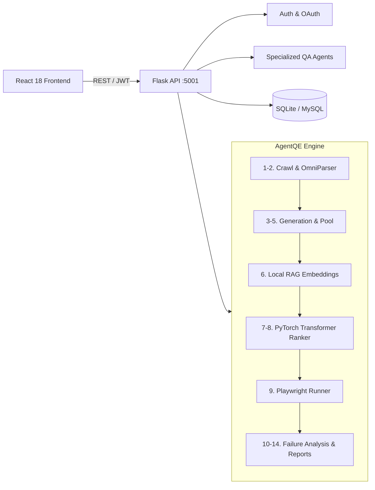

# 🚀 AutoQA AI — Autonomous Multi-Agent Quality Engineering

[](https://www.python.org/)
[](https://reactjs.org/)
[](https://flask.palletsprojects.com/)
[](https://playwright.dev/)
[](https://pytorch.org/)
[](https://www.llamaindex.ai/)
[](LICENSE)

**AutoQA AI** is a multi-agent autonomous Quality Engineering (AgentQE) and QA automation platform. It unites web discovery, requirements parsing, deep learning test prioritization, self-healing browser execution, failure root-cause analysis, and executive reporting into a seamless workflow.

---

## ⚡ Core Capabilities

| Feature | Description |
| :--- | :--- |
| **⚡ 14-Stage AgentQE Pipeline** | End-to-end autonomous quality engineering: Strategy $\rightarrow$ Crawling $\rightarrow$ Multi-Perspective Test Generation $\rightarrow$ RAG $\rightarrow$ ML Prioritization $\rightarrow$ Playwright Execution $\rightarrow$ Failure Analysis $\rightarrow$ Reporting $\rightarrow$ Human Review. |
| **🧠 Deep Learning Prioritization** | Ranks test candidates using a 9-feature PyTorch Transformer (`transformer_ranker.pt`, 64-dim, multi-head attention) with automatic fallback to a deterministic Bootstrap Ranker. |
| **🌐 Visual & Autonomous QA** | Crawls web apps with **OmniParser** bounding-box UI detection and executes tests via **Playwright** with self-healing selector fallback and automated credential redaction. |
| **📚 Local RAG Context** | Embeds project requirements and documentation locally via **LlamaIndex** + `all-MiniLM-L6-v2` without requiring paid embedding APIs. |
| **🛠️ Full-Spectrum QA Toolset** | Manual test-case reviewer, static code security scanner, requirement-to-BDD generator, bug risk & regression predictor, and smart PDF/Excel/image reports. |
| **🔗 GitHub & Dev Intelligence** | GitHub OAuth, PR/commit risk analysis, automated Mermaid architecture diagram generation, and QA-to-Dev team bridge messaging. |
| **💬 AI Assistant** | Floating persistent multi-session chatbot for instantaneous QA guidance. |

---

## 🏗️ Architecture



---

## 📁 Project Structure

```text
autoqa-ai/
├── backend/
│   ├── app.py                     # Flask REST API server (:5001)
│   ├── requirements.txt           # Python dependencies
│   ├── .env.example               # Environment template
│   ├── agentqe/                   # 14-Stage AgentQE autonomous engine
│   │   ├── crawler/               # Web crawling & DOM element inspection
│   │   ├── enrichment/            # RAG context injection
│   │   ├── execution/             # Playwright runner & self-healing selectors
│   │   ├── generation/            # User & engineering test generators
│   │   ├── models/                # transformer_ranker.pt & data schemas
│   │   ├── prioritization/        # Transformer & Bootstrap rankers
│   │   ├── rag/                   # LlamaIndex vector store & retrieval
│   │   ├── training/              # Synthetic data generator & model trainer
│   │   └── vision/                # OmniParser visual UI parsing
│   ├── agents/                    # Specialized QA agents (review, risk, website)
│   ├── database/                  # SQLite (autoqa.db) & MySQL adapter
│   └── tests/                     # Pytest test suites (Phases 1-5, API, RAG)
├── frontend/
│   ├── package.json               # React 18 dependencies
│   ├── src/
│   │   ├── App.jsx                # Route registry & protected layout
│   │   ├── api/client.js          # Axios HTTP client with JWT interceptor
│   │   ├── components/            # Sidebar, Chatbot, loaders, modals
│   │   └── pages/                 # AgentQE, AutonomousQA, Dashboard, etc.
│   └── tailwind.config.js         # Tailwind CSS styling
├── docker-compose.yml             # Multi-container orchestration
└── README.md
```

---

## 🚀 Quick Start

### 1. Backend Setup
```bash
cd backend
python -m venv .venv

# Activate virtual environment
.\.venv\Scripts\Activate.ps1       # Windows
# source .venv/bin/activate         # macOS / Linux

pip install -r requirements.txt
playwright install chromium
cp .env.example .env               # Configure your GROQ_API_KEY / SECRET_KEY

python app.py
# Running on http://localhost:5001 (SQLite auto-initializes locally)
```

### 2. Frontend Setup
```bash
cd frontend
npm install
npm start
# Running on http://localhost:3000
```

### 3. Docker Deployment (Optional)
```bash
docker-compose up --build
# Frontend on :3000, Backend on :5000 (mapped to container 8080)
```

---

## ⚙️ Configuration (`backend/.env`)

| Variable | Description | Default |
| :--- | :--- | :--- |
| `GROQ_API_KEY` | High-speed LLM inference (Llama 3 / Mixtral) for test generation & agents. | — |
| `GEMINI_API_KEY` | Multimodal visual tasks and secondary reasoning fallback. | — |
| `SECRET_KEY` | JWT signing secret (**set a unique random key in production**). | `autoqa-secret-2024` |
| `DB_HOST` | Database host. If `localhost`, local SQLite (`autoqa.db`) is used automatically. | `localhost` |
| `GITHUB_CLIENT_ID` / `SECRET` | GitHub OAuth credentials for repository intelligence. | — |
| `PORT` | Backend HTTP port. | `5001` |

---

## 📡 API Cheat Sheet

| Category | Endpoint | Method | Purpose |
| :--- | :--- | :---: | :--- |
| **Auth** | `/auth/login`, `/auth/register` | `POST` | User registration & JWT authentication |
| **AgentQE** | `/api/agentqe/run` | `POST` | Trigger full 14-stage autonomous QA pipeline |
| | `/api/agentqe/application/understand`| `POST` | Crawl web routes, extract DOM & visual UI |
| | `/api/agentqe/tests/prioritize` | `POST` | Prioritize candidate tests with Transformer ranker |
| | `/api/agentqe/tests/execute` | `POST` | Run tests with Playwright & self-healing selectors |
| | `/api/agentqe/executions/<id>` | `GET` | Fetch traces, step logs, and screenshots |
| **Autonomous**| `/api/autonomous-qa/run` | `POST` | Launch standard autonomous website scan & test run |
| **QA Tools** | `/review-testcase`, `/review-code` | `POST` | Manual test analysis & static code review |
| | `/generate-testcase`, `/predict-risk`| `POST` | Requirement-to-test generation & risk prediction |
| | `/generate-report` | `GET` | Generate consolidated QA summary metrics |
| **Dev Bridge**| `/api/github/analyze` | `POST` | Analyze commit & PR risk |
| | `/api/messages`, `/chat` | `POST` | Team collaboration messaging & floating QA chatbot |

---

## 🧪 Testing

```bash
cd backend
pytest                                          # Run all backend tests
pytest tests/test_agentqe_api.py                # Test AgentQE REST API
pytest tests/test_agentqe_phase4.py             # Test Transformer Ranker
pytest tests/test_agentqe_phase5_execution.py   # Test Playwright Runner
pytest tests/test_agentqe_rag_embedding.py      # Test Local RAG Retrieval
```

---

## 🤝 License

Distributed under the **MIT License**. See `LICENSE` for details.
